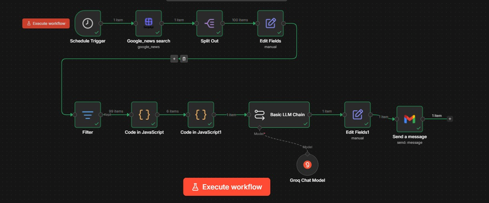
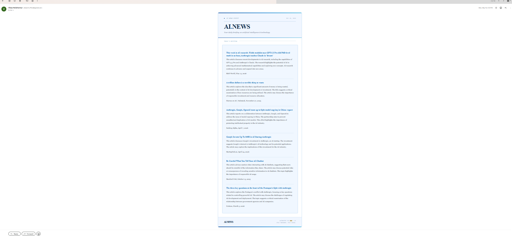

# AI.NEWS — Automated AI News Newsletter (n8n + Groq + Gmail)

A daily workflow that pulls the latest AI headlines from Google News (via SerpAPI), cleans and de-duplicates them, selects the top six, has a Groq-hosted LLM write short summaries, wraps everything in a responsive HTML email, and sends it through Gmail. Originally built during my Data Science internship at Take It Smart (OPC) Pvt. Ltd.

| Workflow (original, from the n8n canvas) | Delivered newsletter (original, Gmail) |
|---|---|
|  |  |

---

## ⚠️ Provenance: what is original vs. reconstructed

The original n8n Cloud trial instance (`vikmh5.app.n8n.cloud`) expired and no export or repo survived. **Nothing in `code/`, `prompts/`, `templates/` or `workflow/` is the original source.** It was rewritten from the two surviving screenshots and my project documentation.

| Item | Status | Basis |
|---|---|---|
| Node order, names and types (Schedule Trigger → Google_news search → Split Out → Edit Fields → Filter → Code ×2 → Basic LLM Chain + Groq → Edit Fields1 → Gmail) | **Recovered** | Canvas screenshot |
| Item counts per step (1 → 1 → 100 → 100 → 99 → 6 → 1 → 1 → 1 → 1) | **Recovered** | Canvas screenshot |
| SerpAPI `google_news` engine, Groq model provider, Gmail send | **Recovered** | Screenshot + documentation |
| Newsletter layout: AI.NEWS title, subtitle, "Today's Briefing", 6 articles (headline link, summary, source + date), footer | **Recovered** (visual) | Gmail screenshot |
| All JavaScript (cleaning, dedupe, relevance, top-6) | **Reconstructed** | Written from documented behaviour |
| LLM system/user prompts | **Reconstructed** | Inferred from output style |
| HTML/CSS source, exact colours, fonts, spacing | **Reconstructed** | Matched by eye to screenshot |
| Search query, schedule time, Groq model name, temperature, filter rules | **Assumed** | See below |
| SerpAPI as HTTP Request node (original may have used a community SerpAPI node) | **Assumed** | Portable on any n8n instance |

### Assumptions
- Search query: `artificial intelligence OR generative AI OR LLM`, US/English.
- Runs daily at 08:00, timezone `Asia/Kolkata` (change in the Schedule Trigger and workflow settings).
- Model: `llama-3.3-70b-versatile` on Groq, temperature 0.3. Swap for any Groq chat model.
- The LLM writes the six article rows (HTML fragment); the `Edit Fields1` node wraps them in the full template. The original may have split this differently.
- The original screenshot shows some older articles (2025), so the original selection was likely not strictly newest-first. This version sorts newest-first.
- Original summaries were hedged ("The article may discuss…"), suggesting title-only prompts. This version also passes the SerpAPI snippet for better summaries.

---

## Architecture

```
Schedule Trigger (daily 08:00)
  → Google_news search   HTTP Request → SerpAPI, engine=google_news            (1 item)
  → Split Out            news_results → one item per article                   (~100)
  → Edit Fields          keep title, link, source, date, snippet               (~100)
  → Filter               drop items missing title or link                      (~99)
  → Code in JavaScript   clean, relevance filter, de-dupe, newest-first, top 6 (6)
  → Code in JavaScript1  build one LLM prompt from the 6 articles              (1)
  → Basic LLM Chain      system prompt + prompt, model: Groq Chat Model        (1)
  → Edit Fields1         wrap LLM rows in the HTML template + build subject    (1)
  → Send a message       Gmail, HTML body                                      (1)
```

### Code node logic (`code/clean-dedupe-select.js`)
1. Normalise titles (strip trailing ` - Source`), validate `http(s)` links.
2. Drop noise (keyword/source blocklist) and anything not AI-related (keyword match on title + snippet).
3. De-duplicate by canonical URL (strips `utm_*`, `www.`, trailing slash), then by title similarity (Jaccard ≥ 0.7). Same story with very different headlines can still slip through.
4. Sort newest-first (relevance score as tie-break), keep six.
5. Original `link` values are passed untouched to the email, so every headline links to the publisher.

### Prompts (`prompts/system.md`)
The model outputs only six `<tr>` rows with the URL, title, source and date copied verbatim and a 2–3 sentence summary grounded in the title/snippet. The system prompt forbids invented facts and URL changes.

---

## Setup

1. **n8n**: Cloud or self-hosted (`npx n8n` / Docker). Import `workflow/ai-news-workflow.json` (Workflows → Import from file).
2. **Credentials** (create, then select in each node):
   - **SerpAPI**: *Query Auth* credential, name `api_key`, value = your SerpAPI key ([serpapi.com](https://serpapi.com), free tier works).
   - **Groq**: *Groq API* credential with a key from [console.groq.com](https://console.groq.com).
   - **Gmail**: *Gmail OAuth2* credential (Google Cloud project with Gmail API enabled).
3. In **Send a message**, replace `YOUR_EMAIL@example.com`.
4. Click **Execute workflow** to test, then toggle the workflow **Active** for the daily schedule.

Never commit API keys; the exported JSON contains only credential placeholders.

## Repository layout

```
workflow/ai-news-workflow.json   importable n8n workflow (generated)
code/                            the two Code-node scripts (source of truth)
prompts/system.md                LLM system prompt
templates/email.html             email template ({{DATE}} / {{ARTICLES}} placeholders)
scripts/build_workflow.py        regenerates the workflow JSON from the files above
tests/                           local test of the Code nodes with sample data
docs/images/                     original screenshots
```

Edit `code/`, `prompts/` or `templates/` and run `python3 scripts/build_workflow.py` to regenerate the importable JSON.

## Testing
- `node tests/run-local.js` runs both Code nodes locally on sample data and asserts: ≤ 6 articles, no duplicate links, links preserved.
- In n8n: execute once and check item counts on each connection (~100 → ~99 → 6 → 1).
- Confirm the Gmail output renders on desktop and mobile and that every headline link opens the publisher page.

## Known limitations
- Not yet run against live SerpAPI/Groq/Gmail; first execution in n8n may need small node-parameter tweaks across n8n versions.
- If the LLM returns malformed HTML, the email degrades; lower the temperature or add a validation Code node.
- Gmail clips long messages and may restyle fonts (Georgia/Courier fallbacks are used).

## License
MIT
